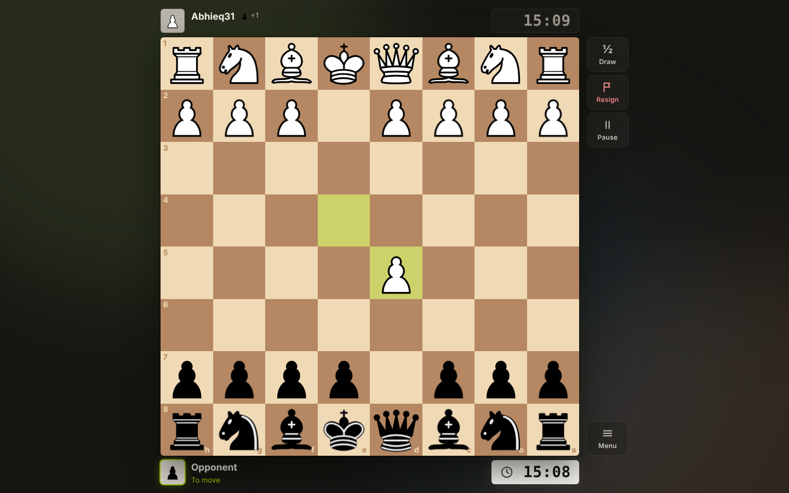
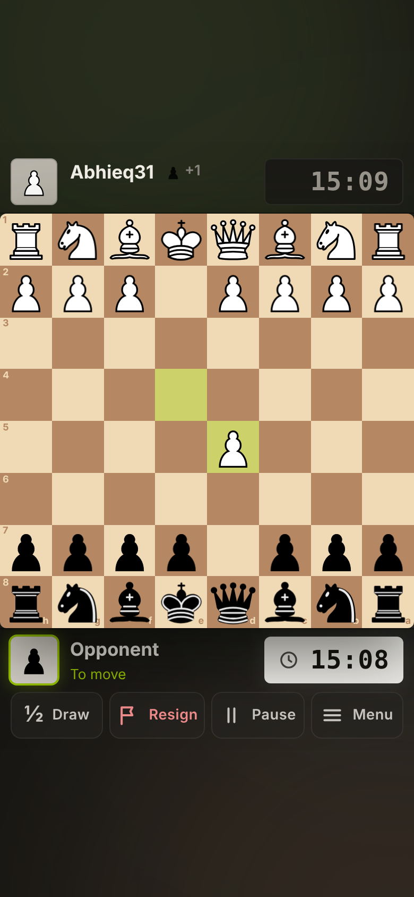
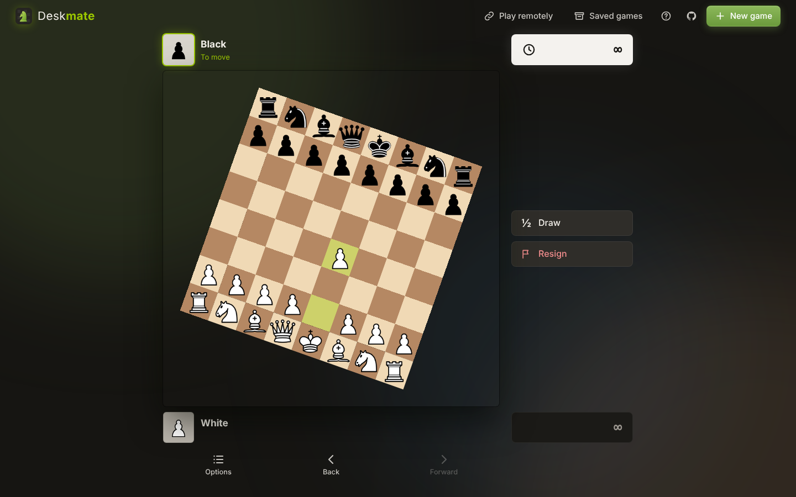

<div align="center">


# Deskmate

**Chess with your colleagues: on one laptop, or across two.**
Put the laptop between you and play, or send game codes through the chat tool you already use.

[**▶ Play now**](https://abhieq31.com/deskmate) · [**⬇ Offline version**](https://abhieq31.github.io/Deskmate/deskmate.html) · [Report a bug](https://github.com/abhieq31/Deskmate/issues/new?template=bug_report.md) · [Suggest a feature](https://github.com/abhieq31/Deskmate/issues/new?template=feature_request.md)




</div>

## Why

Chess sites get blocked on work networks. Deskmate is a static page with no
server, no account, no tracking and no third-party requests. It runs from
GitHub Pages or `localhost`, or as **one HTML file you open by
double-click**. It also works with no network at all.

Please use it in line with your employer's policies. Deskmate keeps
everything local; it is not designed to get around IT controls.

## Features

- **Play a colleague on another laptop with game codes.** After your move
  you get a short code like `DM1-eyJp…`. Paste it into Teams, Slack, email
  or any chat. Your colleague pastes it and moves, then sends a code back.
  There's no server and no account, and nothing to block apart from the chat
  you already use. ([how it works](#play-a-colleague-remotely))
- **The board turns to face whoever is to move.** After every move it spins
  180° and the pieces stay upright. You can turn this off.
- **Move hints like lichess and chess.com.** Click or drag a piece: dots show
  its legal moves and rings show captures.
- **Last move and check highlights.** The from/to squares are tinted and a
  king in check glows red.
- **Full rules.** Castling, en passant and promotion (with a piece picker).
  The game ends on checkmate, stalemate, threefold repetition, the 50-move
  rule or insufficient material.
- **Chess clocks.** Choose from bullet to classical, with increment, pause
  and a low-time warning.
- **Games stay in your browser.** A game in progress survives a reload.
  Finished games go to **Saved games**, where you can review, resume or
  download them as PGN.
- **PGN import and export**, plus copying the FEN of any position.
- **The board is the page.** On screen there are only the two players
  (profile and clock, above and below the board) and a slim rail with
  **Draw**, **Resign** and **Menu**. Code and Pause show up only in games
  that need them. New game, remote play, saved games, the move list,
  settings and PGN tools are all in the menu.
- **Move list with replay.** Use ← → ↑ ↓, or open the menu and click any move.
- **Takeback, agreed draw, resign and rematch** (rematch swaps colours).
- **Right-click arrows and circles** for explaining a line to your opponent.
- **Five board themes**, synthesized move sounds, and the screen stays on
  during a game.
- **Responsive.** Works on a desktop, a tablet or a phone. It can be
  installed as an app (PWA).



## Play a colleague remotely

1. Click **Play remotely → Start a game**, enter both names and pick your colour.
2. You get a **game code** (and a link). Send it to your colleague in any chat.
3. They click the link, or press **Play remotely → I have a code** and paste
   it. They can also press **Ctrl+V** anywhere on the page.
4. After each move Deskmate copies the new code to your clipboard. Send it,
   and paste the reply when it comes back. Repeat until mate. 🙂

Draw offers, resignations and the final result travel inside the codes too.
Each code contains the whole game (one byte per move: a full 30-move game
is about 180 characters). If a code gets lost, the newest one always works.
Codes are checked against the rules, and a code that rewrites earlier
moves is rejected.

How this compares to real-time play: a live "room code" needs a relay
server, or WebRTC with STUN/TURN servers. On a corporate network that's an
outside domain or a UDP path that may be blocked, plus a server someone has
to run and pay for. Text codes need neither: if your chat works, the game
works. The trade-off is that each move takes a paste (a few seconds),
which is fine for a game at your desk.

## Offline version (one file)

[`deskmate.html`](https://abhieq31.github.io/Deskmate/deskmate.html) is the
whole app (about 225 KB) in a single file. Save it anywhere and open it by
double-click. It makes no network requests. Build it yourself with
`npm run build` (writes `deskmate.html`).

## Hosting it on your own site

`deskmate.html` is self-contained (inline CSS, JS and images), so any web
server can host it at any path. Drop it in as `deskmate/index.html`. That's
how [abhieq31.com/deskmate](https://abhieq31.com/deskmate) runs: the file sits
in the site's `public/` folder. It needs `script-src 'unsafe-inline'` and
`img-src data:` if your site sends a Content-Security-Policy.

## Run it locally

No build step and no dependencies. Serve the folder over HTTP:

```bash
git clone https://github.com/abhieq31/Deskmate.git
cd Deskmate
python3 -m http.server 8080      # or: npx serve .
# open http://localhost:8080
```

ES modules don't load from `file://`, so opening `index.html` by double-click won't work.

Run the tests with `npm test`. They need Node 18 or later and nothing else.

## Deploy your own copy

1. Fork this repo.
2. Go to **Settings → Pages → Build and deployment**, choose **Deploy from a
   branch**, then **main** and **/ (root)**.
3. Your copy goes live at `https://<you>.github.io/Deskmate/`. The address is
   case-sensitive and matches the repository name exactly. Every push to
   `main` updates it. `.github/workflows/test.yml` runs the tests on each
   push and pull request.

Any static host works too (Netlify, Cloudflare Pages, an internal web
server): copy the repository as it is. No build step is needed to serve it.

## Project layout

```
index.html            page shell & dialogs
css/style.css         all styling (themes, board, animations, responsive layout)
js/app.js             controller: UI wiring, clocks, persistence, dialogs
js/board.js           interactive board: render, click/drag, hints, arrows, flip
js/game.js            game model on top of chess.js: plies, results, PGN (pure, tested)
js/remote.js          game codes for remote play: encode/decode/compare (pure, tested)
js/storage.js         localStorage wrapper
js/sound.js           Web Audio synthesized sounds
js/confetti.js        celebration effect
sw.js                 offline cache (service worker)
scripts/build-single.mjs  bundles everything into deskmate.html (no deps)
deskmate.html         generated offline build (commit it after changes: `npm run build`)
vendor/chess.js       chess rules engine (chess.js 1.4.0, BSD-2-Clause)
tests/                node:test unit tests for js/game.js and js/remote.js
```

## Contributing

Contributions are welcome, from typo fixes to new features. See
[CONTRIBUTING.md](CONTRIBUTING.md). Some ideas:

- Opening name display (ECO lookup)
- Post-game analysis with a WebAssembly Stockfish build
- More piece sets and board themes
- Play from a custom FEN position or Chess960
- Translations
- An optional real-time mode for networks that allow it (WebRTC/WebSocket), with codes as the fallback
- Clocks for remote games (store the time used per move in the code)

## Credits & licenses

- Deskmate source code: [MIT](LICENSE)
- Rules engine: [chess.js](https://github.com/jhlywa/chess.js) by Jeff Hlywa, BSD-2-Clause
- Pieces: *cburnett* set by Colin M.L. Burnett, GPLv2+, via [lichess](https://github.com/lichess-org/lila). See [assets/pieces/cburnett/LICENSE.md](assets/pieces/cburnett/LICENSE.md)
- Visual language inspired by [lichess.org](https://lichess.org). Please support them.

Please use Deskmate where your employer's policies allow it.
