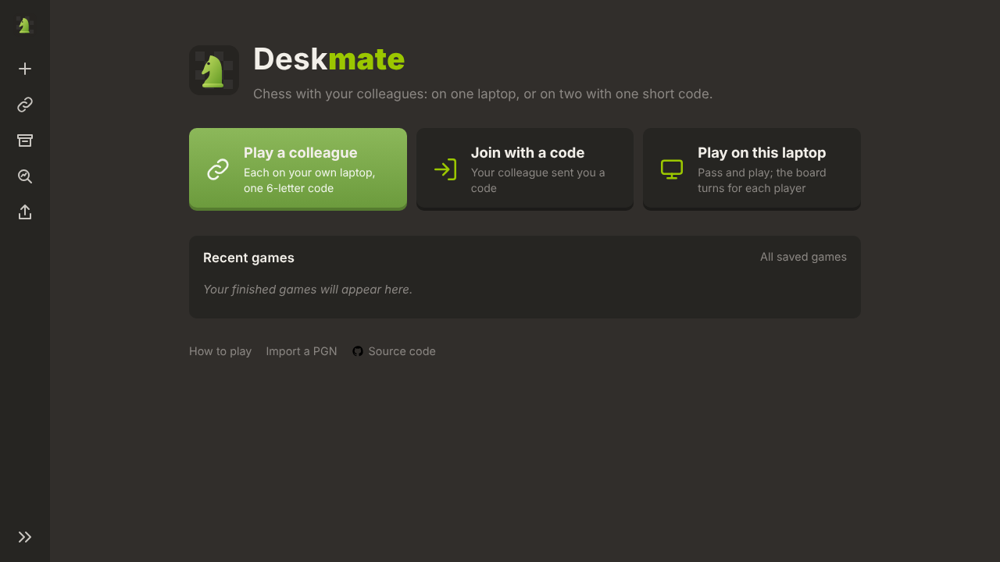
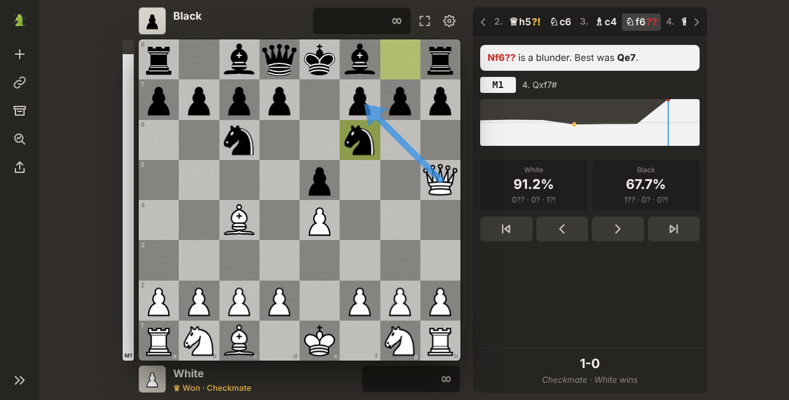
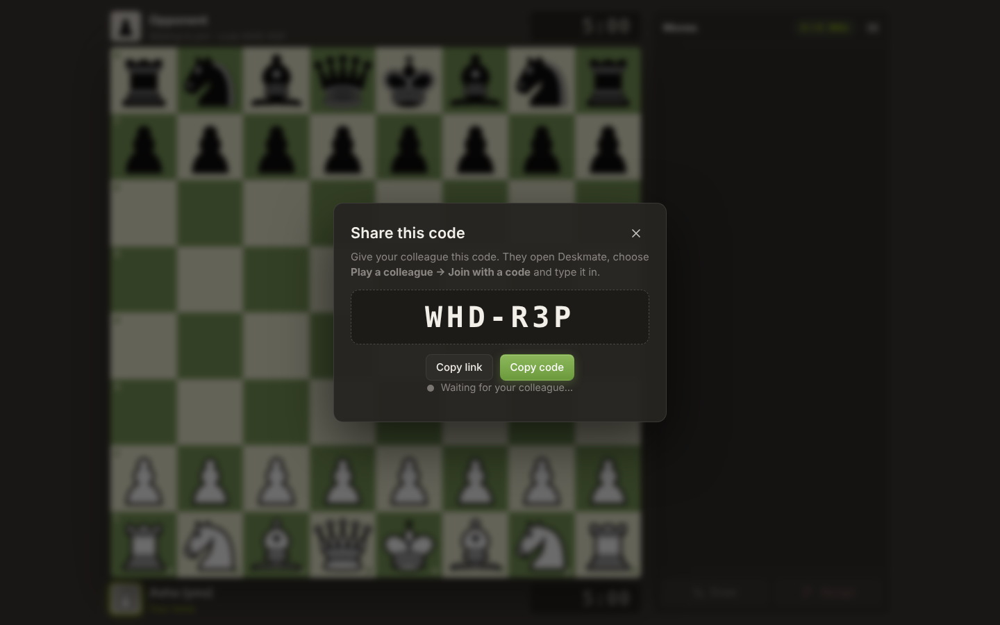

<div align="center">


# Deskmate

**Chess with your colleagues: on one laptop, or across two.**
Share one short code and play live, each on your own work laptop. Or put one laptop between you.

[**▶ Play now**](https://abhieq31.com/deskmate) · [**⬇ Offline version**](https://github.com/abhieq31/Deskmate/raw/main/deskmate.html) · [Report a bug](https://github.com/abhieq31/Deskmate/issues/new?template=bug_report.md) · [Suggest a feature](https://github.com/abhieq31/Deskmate/issues/new?template=feature_request.md)




</div>

## Why

Chess sites get blocked on work networks. Deskmate is a static page with no
account, no tracking and no Deskmate server. Two colleagues can play on one
laptop, or each on their own laptop with one short code.

Please use it in line with your employer's policies.

## Features

- **Play a colleague on their own laptop.** One of you creates a game and
  gets a 6-character code like `K7Q-M2X`. The other types it in once, and
  moves appear on both screens within moments. Clocks, draw offers,
  resignations and rematches sync too. ([How it works](#play-a-colleague))
- **A home page** with Play a colleague, Join with a code, Play on this
  laptop, Resume, and your recent games with Review and Analyse. The logo
  always brings you back to it.
- **Focus mode while you play** (on by default). The board is as large as
  the window allows, with only the players (name, captured pieces, points
  lead) and their clocks, and small ½ / ⚑ buttons for draw and resign. The
  expand button at the board's top-right corner (or **Z**) brings back the
  chess.com-style view: an icon sidebar, one line of moves top right, and
  chess.com's quiet "½ Draw ⚑ Resign" buttons.
- **Replay with clocks.** Stepping back through a game shows each clock as
  it stood at that move, and exported PGNs carry `[%clk]` times like
  lichess and chess.com.
- **Two boards:** chess.com green and grey stone (settings ⚙).
- **Fluid pieces.** Pressing a piece lifts it under the cursor, and it
  follows the pointer once per screen frame. The target square is outlined
  while you drag, and click-to-move works too.
- **Post-game analysis with Stockfish.** Once a game ends (or for any saved
  or imported game), Stockfish 11 analyses every move in your browser. You
  get an evaluation bar, the engine's best line and an arrow for its best
  move, an evaluation graph, accuracy for both players, and ?? / ? / ?!
  marks on blunders, mistakes and inaccuracies, the way lichess calculates
  them. A chess.com-style line names the move ("Nf6?? is a blunder. Best
  was Qe7."). There is no engine during play.
- **Same-laptop games.** After each move the board switches to the side of
  whoever moves next. The view just changes; nothing spins. (Auto-flip can be
  turned off in the menu.)
- **Move hints.** Click or drag a piece: dots show its legal moves, rings
  show captures. The last move is highlighted, and a king in check glows.
- **Full rules.** Castling, en passant and promotion (with a piece picker).
  The game ends on checkmate, stalemate, threefold repetition, the 50-move
  rule or insufficient material.
- **Clocks** from bullet to classical, with increment.
- **Quiet.** The only sound is a soft water drop when a piece is captured.
- **Games stay in your browser.** A game in progress survives a reload.
  Finished games go to **Saved games** (review, resume, PGN download).
- **PGN import/export**, FEN copy and takeback (same-laptop games).



## Play a colleague

1. **☰ → Play a colleague → Start a game.** Enter your name, pick a colour
   and a clock, then press **Create game**. You get a code like `K7Q-M2X`.
2. Your colleague opens Deskmate and goes to **☰ → Play a colleague → Join
   with a code**, then types the code and their name. You can also send them
   the link (`…/deskmate#K7QM2X`), which fills the code in for them.
3. That's it. The game is live on both laptops until it ends, and **Rematch**
   swaps colours in the same room. If a laptop reloads or loses its connection,
   it rejoins the game by itself.



### How it works

Deskmate has no server of its own. The two browsers exchange the game
through public [Nostr](https://nostr.com) relays: plain secure WebSockets on
port 443 to `relay.damus.io`, `nos.lol`, `relay.primal.net` and
`offchain.pub`. Every update goes to all four at once, so the game keeps
going while any one of them is up.

Each update is the whole game state, a few hundred bytes: one byte per move,
plus the clocks and the result. It is signed with a key derived from the room
code, so a relay can't alter it. Anyone who has the code can see the game,
so treat it like a meeting link.

**Company networks.** If your network blocks those relays, you can run any
Nostr relay internally and point Deskmate at it. Run this in the browser
console:
`localStorage['deskmate:relays'] = '["wss://relay.your-company.internal"]'`.
If you host Deskmate behind a Content-Security-Policy, allow the relays in
`connect-src`.

## Offline version (one file)

[`deskmate.html`](https://github.com/abhieq31/Deskmate/raw/main/deskmate.html)
is the whole app (about 310 KB) in a single file. Save it anywhere and open
it by double-click. Same-laptop games need no network at all. Live games with
a colleague need to reach the relays. Analysis needs the hosted page, because
browsers don't run the engine's worker from a local file. Build it yourself with `npm run build`
(writes `deskmate.html`).

## Hosting it on your own site

`deskmate.html` is self-contained (inline CSS, JS and images), so any web
server can host it at any path. Drop it in as `deskmate/index.html`, with
`vendor/stockfish/` next to it (`deskmate/vendor/stockfish/`) for analysis. That's
how [abhieq31.com/deskmate](https://abhieq31.com/deskmate) runs: the file sits
in the site's `public/` folder. If your site sends a Content-Security-Policy,
it needs `script-src 'unsafe-inline'`, `img-src data:` and the relays in
`connect-src`.

## Run it locally

No build step and no dependencies. Serve the folder over HTTP:

```bash
git clone https://github.com/abhieq31/Deskmate.git
cd Deskmate
python3 -m http.server 8080      # or: npx serve .
# open http://localhost:8080
```

ES modules don't load from `file://`, so opening `index.html` by double-click won't work.

Run the tests with `npm test`. They need Node 18 or later and nothing else.

## Deploy your own copy

1. Fork this repo.
2. Go to **Settings → Pages → Build and deployment**, choose **Deploy from a
   branch**, then **main** and **/ (root)**.
3. Your copy goes live at `https://<you>.github.io/Deskmate/`. The address is
   case-sensitive and matches the repository name exactly. Every push to
   `main` updates it. `.github/workflows/test.yml` runs the tests on each
   push and pull request.

Any static host works too (Netlify, Cloudflare Pages, an internal web
server): copy the repository as it is. No build step is needed to serve it.

## Project layout

```
index.html            page shell & dialogs
css/style.css         all styling (themes, board, animations, responsive layout)
js/app.js             controller: UI wiring, clocks, persistence, dialogs
js/board.js           interactive board: render, click/drag, hints, arrows, flip
js/game.js            game model on top of chess.js: plies, results, PGN (pure, tested)
js/live.js            live rooms: room codes, signed snapshots over Nostr relays (tested)
js/remote.js          compact move encoding for snapshots, one byte per move (tested)
js/engine.js          Stockfish in a Web Worker over UCI (contempt off for analysis)
js/analysis.js        win chances, ??/?/?! classification, accuracy (tested)
js/storage.js         localStorage wrapper
js/sound.js           Web Audio synthesized sounds
js/confetti.js        celebration effect
sw.js                 offline cache (service worker)
scripts/build-single.mjs  bundles everything into deskmate.html (no deps)
deskmate.html         generated offline build (commit it after changes: `npm run build`)
vendor/chess.js       chess rules engine (chess.js 1.4.0, BSD-2-Clause)
vendor/secp256k1.js   Schnorr signatures for room snapshots (noble-secp256k1 3.2.0, MIT)
vendor/stockfish/     Stockfish 11 WebAssembly build, loaded only for analysis (GPLv3)
tests/                node:test unit tests for the game model, move encoding and live rooms
```

## Contributing

Contributions are welcome, from typo fixes to new features. See
[CONTRIBUTING.md](CONTRIBUTING.md). Some ideas:

- Opening name display (ECO lookup)
- More piece sets and board themes
- Play from a custom FEN position or Chess960
- Translations
- A direct WebRTC connection between the two laptops when the network allows it, with relays as the fallback

## Credits & licenses

- Deskmate source code: [MIT](LICENSE)
- Rules engine: [chess.js](https://github.com/jhlywa/chess.js) by Jeff Hlywa, BSD-2-Clause
- Signatures: [noble-secp256k1](https://github.com/paulmillr/noble-secp256k1) by Paul Miller, MIT
- Analysis: [Stockfish](https://stockfishchess.org) 11, compiled to WebAssembly by [stockfish.js](https://github.com/nmrugg/stockfish.js), GPLv3. It is a separate program that Deskmate runs in a Web Worker. See [vendor/stockfish/README.md](vendor/stockfish/README.md)
- Pieces: *cburnett* set by Colin M.L. Burnett, GPLv2+, via [lichess](https://github.com/lichess-org/lila). See [assets/pieces/cburnett/LICENSE.md](assets/pieces/cburnett/LICENSE.md)
- Visual language inspired by [lichess.org](https://lichess.org). Please support them.

Please use Deskmate where your employer's policies allow it.
